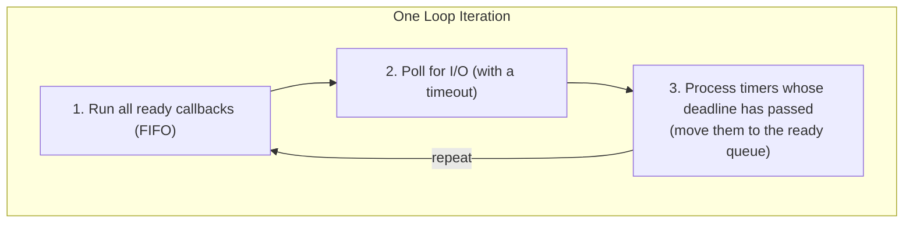

# The Event Loop

You already know how to write async programs. You can spawn tasks in a
[`TaskGroup`][taskgroup], cancel them with
timeouts, offload blocking work to threads. All
of that sits on top of a single piece of machinery: the *event loop*. This
section opens the hood and shows you what that machinery looks like.

Understanding the event loop is not something you need for everyday coding. But
when a timeout fires later than you expected, when a task appears to starve, or
when you want to know what `#!py await asyncio.sleep(0)` actually *does* -- this is
where the answers live.

## The Loop Iteration

The event loop is a single-threaded scheduler. It runs one callback at a time,
in a loop that repeats until there is nothing left to do. Each turn of that
loop -- one *iteration* -- follows the same three-phase pattern:



Here is rough pseudocode for what the loop does on every turn:

```python hl_lines="4 5 6 9 10 11 12 15 16 17 18"
# Pseudocode -- not real asyncio source, but faithful to the logic.
while self._ready or self._scheduled or self._selector.get_map():
    # Phase 1: drain the ready queue
    ntodo = len(self._ready)
    for _ in range(ntodo):
        callback = self._ready.popleft()
        callback.run()

    # Phase 2: compute how long we can block waiting for I/O
    timeout = 0.0 if self._ready else self._calculate_timeout()
    events = self._selector.select(timeout)
    for key, mask in events:
        self._ready.append(key.data)  # move I/O callbacks to ready queue

    # Phase 3: check the timer heap
    now = self.time()
    while self._scheduled and self._scheduled[0].when <= now:
        timer = heapq.heappop(self._scheduled)
        self._ready.append(timer.callback)
```

A few things to notice:

- **Phase 1 drains the ready queue completely** before doing anything else.
  The loop snapshots the queue length (`ntodo`) so that callbacks added *during*
  this phase land in the *next* iteration, not this one.
- **Phase 2 asks the OS for I/O events.** This is a call to
  [`select()`][select] (or `epoll`,
  `kqueue`, etc., depending on your platform). If the ready queue is empty, the
  loop blocks here until I/O arrives or the next timer fires -- this is how
  asyncio avoids busy-spinning.
- **Phase 3 scans the timer heap.** Any timer whose deadline has passed gets
  moved to the ready queue. Those callbacks will run on the *next* iteration.

This is the entire scheduling algorithm. There is no thread pool, no priority
system, no preemption. One callback runs. It finishes. The next one runs.

## [`call_soon()`][call-soon]

[`loop.call_soon()`][loop-call-soon]
places a callback on the ready queue. It will execute during phase 1 of the
next loop iteration (or the current one, if the queue hasn't been fully drained
yet -- but conceptually, think "next iteration").

```python title="call_soon_demo.py"
import asyncio

def on_ready(message: str) -> None:
    loop = asyncio.get_running_loop()
    print(f"[{loop.time():.4f}] callback fired: {message}")

async def main() -> None:
    loop = asyncio.get_running_loop()
    print(f"[{loop.time():.4f}] scheduling callbacks")

    loop.call_soon(on_ready, "first")
    loop.call_soon(on_ready, "second")
    loop.call_soon(on_ready, "third")

    # Yield control so the loop can run the callbacks
    await asyncio.sleep(0)
    print(f"[{loop.time():.4f}] back in main")

if __name__ == "__main__":
    asyncio.run(main())
```

```text title="$ python call_soon_demo.py"
[0.0003] scheduling callbacks
[0.0003] callback fired: first
[0.0003] callback fired: second
[0.0003] callback fired: third
[0.0004] back in main
```

The three callbacks ran in registration order, all at essentially the same
time. That `#!py await asyncio.sleep(0)` is what gave the loop the chance to run
them -- without it, `main` would hold the loop and the callbacks would only
fire after `main` returned.

This is a low-level API. You will rarely call it directly, but it matters
because it is the foundation. When you call `#!py tg.create_task(some_coro())`,
asyncio creates a [`Task`][task] object and then calls `call_soon` to schedule the
first step of that task. Every task begins life as a callback on the ready
queue.

!!! note

    `call_soon` returns a
    [`Handle`][handle]
    object. You can call `#!py handle.cancel()` to prevent the callback from
    running, as long as it hasn't been executed yet.

## Timers: `#!py call_later()` and `#!py call_at()`

[`loop.call_later(delay, callback, *args)`][loop-call-later-delay-callback-args]
schedules a callback to run after *delay* seconds.
[`loop.call_at(when, callback, *args)`][loop-call-at-when-callback-args]
schedules a callback at an absolute time on the loop's internal clock. Both
return a
[`TimerHandle`][timerhandle]
that you can cancel.

```python title="timers_demo.py"
import asyncio

def tick(label: str) -> None:
    loop = asyncio.get_running_loop()
    print(f"[{loop.time():.4f}] {label}")

async def main() -> None:
    loop = asyncio.get_running_loop()
    start: float = loop.time()

    loop.call_later(0.3, tick, "call_later 0.3s")
    loop.call_later(0.1, tick, "call_later 0.1s")
    loop.call_at(start + 0.2, tick, "call_at start+0.2s")

    # Keep the loop alive long enough for all timers to fire
    await asyncio.sleep(0.5)
    print(f"[{loop.time():.4f}] done")

if __name__ == "__main__":
    asyncio.run(main())
```

```text title="$ python timers_demo.py"
[0.1005] call_later 0.1s
[0.2005] call_at start+0.2s
[0.3006] call_later 0.3s
[0.5007] done
```

Even though the 0.3s timer was registered first, the 0.1s timer fires first.
The timer heap is sorted by deadline, not by registration order.

### [`loop.time()`][loop-time]

[`loop.time()`][loop-time]
returns the current time as a `float`, according to the event loop's
*monotonic clock*. This is the same kind of clock as
[`time.monotonic()`][time-monotonic]
-- it never goes backwards, and it is not affected by system clock adjustments.
All timer deadlines are expressed in terms of this clock.

When you call `#!py loop.call_later(0.5, cb)`, asyncio computes
`#!py loop.time() + 0.5` and inserts that into the timer heap. `call_later` is just
a convenience wrapper around `call_at`.

!!! info

    [`asyncio.sleep()`][asyncio-sleep] is built on `#!py call_later()` under the hood. When you
    write `#!py await asyncio.sleep(1.0)`, asyncio creates a [`Future`][future], schedules
    a `call_later` to resolve it after one second, and suspends your
    coroutine until that future completes. Now you know why it is a
    checkpoint -- your coroutine genuinely gives up control and waits for a
    timer callback to wake it.

## Cooperative Scheduling

In [The Basics](../the-basics/getting-started.md#checkpoints)
you learned that every [`await`][await] is a potential checkpoint -- a place where the
loop *may* pause your coroutine and let other tasks run. You also learned the
`#!py await asyncio.sleep(0)` idiom for forcing a yield. That is the user-facing
mental model, and it is enough for most day-to-day work.

Here you will see what the loop actually *does* when your coroutine hits one of
those checkpoints.

### How a checkpoint works, mechanically

A coroutine is driven by a [`Task`][task] (covered fully in
[Tasks and Futures](tasks-and-futures.md)). When the task calls
`#!py coro.send(None)` and the coroutine reaches an [`await`][await] that needs to suspend,
the coroutine *yields* a [`Future`][future] back to the task. The task then does two
things:

1. It registers a callback on that future: "when this future is done, call
   `task.__step` to resume me."
2. It **returns** -- giving control back to the loop.

At that point, the loop is free. It drains whatever is left in the ready queue,
polls for I/O, checks timers, and eventually the future completes (because a
timer fired, data arrived on a socket, etc.). The completion triggers the
callback from step 1, which places `task.__step` back onto the ready queue.
Next time the loop reaches phase 1, it calls `task.__step`, which calls
`#!py coro.send(result)`, and your coroutine picks up right where it left off.

That is the full round trip. No magic, no thread switching, no signals -- just
callbacks and a queue.

### When an [`await`][await] is *not* a checkpoint

Not every [`await`][await] causes a suspension. If you [`await`][await] a coroutine that returns
a value without itself suspending, the `Task.__step` method receives the result
immediately and keeps driving the coroutine in the *same* callback, without
ever returning to the loop. From the scheduler's perspective, it is as if the
[`await`][await] never happened.

This is why a chain of [`await`][await] calls into pure-computation coroutines runs
without yielding. The loop only regains control when the coroutine yields a
*pending* future -- one that is not already resolved.

### What starvation looks like from the loop's perspective

You already know that forgetting to yield starves other tasks. Now you can see
*why* in terms of the loop phases. Consider this scenario:

```python title="starvation_demo.py"
import asyncio
import time

async def hog() -> None:
    """Simulates a coroutine that does too much work without yielding."""
    print("hog: starting heavy computation")
    total: int = 0
    start: float = time.monotonic()
    # Burn CPU for ~1 second with no await
    while time.monotonic() - start < 1.0:
        total += 1
    print(f"hog: done ({total:,} iterations)")

async def polite() -> None:
    for i in range(5):
        print(f"polite: tick {i}")
        await asyncio.sleep(0.2)

async def main() -> None:
    t0: float = time.monotonic()
    async with asyncio.TaskGroup() as tg:
        tg.create_task(hog())
        tg.create_task(polite())
    elapsed: float = time.monotonic() - t0
    print(f"Total time: {elapsed:.1f}s")

if __name__ == "__main__":
    asyncio.run(main())
```

```text title="$ python starvation_demo.py"
hog: starting heavy computation
hog: done (8,432,109 iterations)
polite: tick 0
polite: tick 1
polite: tick 2
polite: tick 3
polite: tick 4
Total time: 2.0s
```

Here is exactly what happened inside the loop:

1. Both tasks were created, placing two `task.__step` callbacks on the ready
   queue.
2. Phase 1 pops `hog`'s step callback. `hog` starts running and never hits a
   suspending [`await`][await], so `task.__step` never returns. The loop is stuck
   inside phase 1 for the full second.
3. During that second, `polite`'s step callback is sitting in the ready queue
   doing nothing. The timer for `polite`'s first `#!py sleep(0.2)` cannot even be
   *checked* because the loop never reaches phase 3.
4. When `hog` finally returns, the loop finishes phase 1, does a zero-timeout
   I/O poll in phase 2, processes the now-overdue timers in phase 3, and only
   *then* does `polite` start ticking.

The total wall time is ~2 seconds (1s for `hog` + 1s for `polite`'s sleeps in
series) instead of the ~1s you would see if they overlapped.

!!! tip

    If a computation is genuinely heavy, sprinkling `#!py await asyncio.sleep(0)`
    every N iterations is a band-aid. The better solution is
    [`asyncio.to_thread()`][asyncio-to-thread] or [`loop.run_in_executor()`][loop-run-in-executor] with a
    [`ProcessPoolExecutor`][processpoolexecutor], as covered in
    [Blocking Code](../beyond-the-basics/blocking-code.md). Reserve
    `#!py sleep(0)` for cases where the overhead of a thread switch is not
    justified.

## Fairness

Within a single loop iteration, callbacks are strictly FIFO -- first in, first
out. If callbacks A, B, and C are all in the ready queue when the iteration
starts, they run in exactly that order. There is no priority system, no
time-slicing, no way for one callback to jump the queue.

This also means: **all ready callbacks run before I/O is polled again.** If 50
callbacks are sitting in the ready queue, all 50 execute before the loop checks
for new network data. If those callbacks are slow, I/O processing is delayed.

For tasks (which are driven by callbacks under the hood), the scheduling is
interleaved one step at a time. When a task hits an [`await`][await] that suspends, its
*continuation* -- the callback that will resume it -- goes to the back of the
ready queue. This gives other tasks a chance to take a step before this task
runs again.

```python title="fairness_demo.py"
import asyncio

async def worker(name: str) -> None:
    for i in range(3):
        print(f"{name}: step {i}")
        await asyncio.sleep(0)  # Yield after each step

async def main() -> None:
    async with asyncio.TaskGroup() as tg:
        tg.create_task(worker("A"))
        tg.create_task(worker("B"))
        tg.create_task(worker("C"))

if __name__ == "__main__":
    asyncio.run(main())
```

```text title="$ python fairness_demo.py"
A: step 0
B: step 0
C: step 0
A: step 1
B: step 1
C: step 1
A: step 2
B: step 2
C: step 2
```

A, B, and C take turns in perfect round-robin order. Each `await
asyncio.sleep(0)` sends the current task to the back of the ready queue, and
the next task gets its turn. This is the only form of "fairness" asyncio
provides -- there is no preemption, no time budgets, no automatic yielding.

!!! note

    The output order above depends on the order in which tasks were created.
    If you need a specific execution order between tasks, use explicit
    coordination primitives ([`Event`][event], [`Queue`][queue], etc.) from
    [Coordination](../the-basics/coordination.md). Relying on
    scheduling order is fragile.

## Why This Matters

None of this is abstract. Here are the practical situations where knowing the
loop model pays off:

- **"My timeout fired late."** Timeouts are timers, and timers are checked in
  phase 3 of the loop iteration. If a long-running callback is hogging
  phase 1, the loop cannot even *check* whether your timer has expired. The
  timer is not broken -- the loop just hasn't gotten to phase 3 yet.

- **"My task seems stuck."** If another task is running a blocking call or a
  long computation without yielding, your task is sitting in the ready queue
  waiting for its turn. The loop is not deadlocked; it is busy running someone
  else's code.

- **"I added a callback but it didn't run."** Callbacks added with `call_soon`
  during phase 1 run on the *next* iteration, not the current one. If you
  expected immediate execution, you are off by one loop turn.

- **"My `#!py sleep(0)` didn't help."** `#!py sleep(0)` yields to the loop, but if
  the ready queue has 200 other callbacks ahead of you, you won't resume
  until they have all run. It is a yield, not a priority boost.

The event loop is simple. That simplicity is what makes asyncio fast and
predictable -- but it also means the loop cannot save you from yourself. If
you block it, everything stops. If you don't yield, nobody else runs. The
machinery does exactly what the pseudocode says, nothing more.

---

[taskgroup]: https://docs.python.org/3/library/asyncio-task.html#asyncio.TaskGroup
[select]: https://docs.python.org/3/library/selectors.html
[call-soon]: https://docs.python.org/3/library/asyncio-eventloop.html#asyncio.loop.call_soon
[loop-call-soon]: https://docs.python.org/3/library/asyncio-eventloop.html#asyncio.loop.call_soon
[task]: https://docs.python.org/3/library/asyncio-task.html#asyncio.Task
[handle]: https://docs.python.org/3/library/asyncio-eventloop.html#asyncio.Handle
[loop-call-later-delay-callback-args]: https://docs.python.org/3/library/asyncio-eventloop.html#asyncio.loop.call_later
[loop-call-at-when-callback-args]: https://docs.python.org/3/library/asyncio-eventloop.html#asyncio.loop.call_at
[timerhandle]: https://docs.python.org/3/library/asyncio-eventloop.html#asyncio.TimerHandle
[loop-time]: https://docs.python.org/3/library/asyncio-eventloop.html#asyncio.loop.time
[time-monotonic]: https://docs.python.org/3/library/time.html#time.monotonic
[asyncio-sleep]: https://docs.python.org/3/library/asyncio-task.html#asyncio.sleep
[future]: https://docs.python.org/3/library/asyncio-future.html#asyncio.Future
[await]: https://docs.python.org/3/reference/expressions.html#await
[asyncio-to-thread]: https://docs.python.org/3/library/asyncio-task.html#asyncio.to_thread
[loop-run-in-executor]: https://docs.python.org/3/library/asyncio-eventloop.html#asyncio.loop.run_in_executor
[processpoolexecutor]: https://docs.python.org/3/library/concurrent.futures.html#concurrent.futures.ProcessPoolExecutor
[event]: https://docs.python.org/3/library/asyncio-sync.html#asyncio.Event
[queue]: https://docs.python.org/3/library/asyncio-queue.html#asyncio.Queue