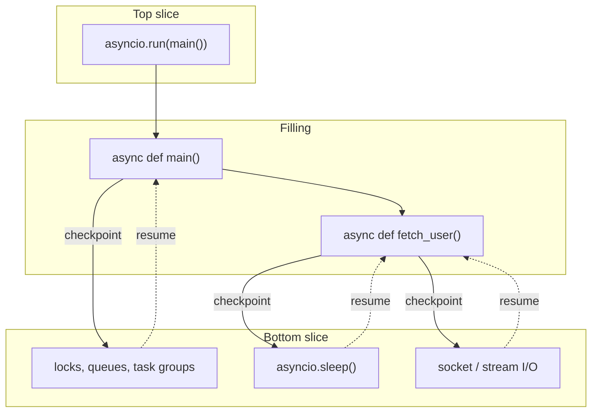

# Getting Started

This section introduces the core vocabulary of asyncio: coroutines,
[`await`][await], [`asyncio.run()`][asyncio-run], and
[`asyncio.sleep()`][asyncio-sleep]. By the end you will be able to write and
run a simple async program and understand what happens under the hood.
Everything here is sequential --
[Concurrent Tasks](concurrent-tasks.md) covers running things concurrently.

!!! Tip

    This section teaches the first mental model. For the full language-and-stdlib
    reference on coroutines, awaitables, and the broader conceptual model, the
    official [Conceptual Overview of `asyncio`][conceptual-overview] is also
    worth reading.

## Hello World!

An *async function* (also called a *coroutine function*) is any function
defined with `#!py async def` instead of plain `#!py def`. Let's start with a
complete, working program:

```python title="hello_async.py"
import asyncio

async def greet(name: str) -> str:
    return f"Hello, {name}"

async def main() -> None:
    message: str = await greet("world")  # (1)!
    print(message)

if __name__ == "__main__":
    asyncio.run(main())  # (2)!
```

1. [`await`][await] drives the coroutine to completion and gives you the return
   value. Without it, `#!py greet("world")` returns a coroutine object instead
   of a string.
2. [`asyncio.run()`][asyncio-run] is the bridge between sync and async. It
   creates an event loop, runs `#!py main()` to completion, and tears the loop
   down. Call it **once**, at the top level of your program.

```text title="$ python hello_async.py"
Hello, world
```

Here is what happens when you run this:

1. `#!py async def greet` and `#!py async def main` define coroutine functions.
2. [`asyncio.run()`][asyncio-run] creates an event loop, drives `#!py main()`
   to completion, and tears the loop down cleanly. It is the bridge between the
   synchronous world and the async world.
3. Inside `main`, `#!py await greet("world")` calls the coroutine function,
   drives the resulting coroutine to completion, and gives you back its return
   value.

That is the pattern you will use in nearly every asyncio program: define an
`#!py async def main()`, put your logic there, and call `#!py
asyncio.run(main())` at the bottom. [`asyncio.run()`][asyncio-run] is meant to
be called **once**, at the top level of your program.

## Cooperative Scheduling

Python gives you two main tools for concurrency: threads and asyncio. They
solve the same problem -- doing more than one thing at a time -- but they work
in fundamentally different ways.

With **threads**, the operating system preempts your code at any point.
Multiple threads can genuinely run in parallel, but you need locks to protect
shared state because interruption is invisible and unpredictable.

With **asyncio**, your code runs on a single thread and only yields control
when it hits an [`await`][await]. Only one coroutine executes at a time. The
tradeoff: you can never be interrupted mid-statement, so you rarely need locks
-- but you must cooperate by awaiting regularly, or you will block everyone
else.

## The Event Loop

You do not need the full scheduler internals yet, but a tiny bit of conceptual
pseudocode helps make the mental model concrete.

With just one coroutine, the event loop can be pictured like this:

```python title="Conceptual loop pseudocode"
while True:
    event = coro.resume()   # (1)!
    if event is None:       # (2)!
        break

    wait_for_event(event)   # (3)!
```

1. Run the coroutine until it yields because it is waiting for something.
2. `#!py None` means the coroutine finished, so the loop can stop.
3. Block until that event happens, then resume the coroutine.

That is why asyncio is called *cooperative*: your code runs until it reaches a
checkpoint, then gives the loop a chance to do something else. In this example
we are only running one couroutine in the loop, so there is no "something else"
yet -- but as things get more complicated, the loop will have more stuff to do
than dealing with a single coroutine.

[Concurrent Tasks](concurrent-tasks.md) adds the missing complication: more
than one task can be ready or waiting at once.
[How Asyncio Works](../how-asyncio-works/index.md) then comes back and shows
the fuller scheduler picture with ready queues, timers, callbacks, and
cancellation.

## `await`

The [`await`][await] keyword does two things:

1. It waits for a coroutine (or any other *awaitable*) to finish and gives you
   back its result.
2. It marks a potential *checkpoint* -- a place where the event loop
   **may** pause your coroutine and go do other work.

You can only use [`await`][await] inside an `#!py async def`. This is enforced
by the Python interpreter, not by convention. If you try to use it in a regular
function you will get a [`SyntaxError`][syntaxerror].

Here is a small example that chains two async calls and uses the return values:

```python title="await_demo.py"
import asyncio

async def add(a: int, b: int) -> int:
    return a + b

async def double(n: int) -> int:
    return n * 2

async def main() -> None:
    total: int = await add(3, 4)
    result: int = await double(total)
    print(f"3 + 4 = {total}, doubled = {result}")

if __name__ == "__main__":
    asyncio.run(main())
```

```text title="$ python await_demo.py"
3 + 4 = 7, doubled = 14
```

Nothing surprising yet -- this looks and behaves exactly like synchronous code.
The difference only becomes visible once there are multiple tasks (next
section) and real I/O operations. For now, just remember: **every call to an
async function must be [`await`][await]-ed** (or explicitly scheduled, covered
later).

## Forgetting to `await`

Calling an async function does **not** execute its body. It returns a
*coroutine object* -- a little package of suspended work that must be driven by
the event loop (or by [`await`][await]). If you forget that step, the body
never runs.

```python title="wrong_call.py"
import asyncio

async def greet(name: str) -> str:
    return f"Hello, {name}"

if __name__ == "__main__":
    greet("world")  # Oops -- this never drives the coroutine
```

```text title="$ python wrong_call.py"
wrong_call.py:7: RuntimeWarning: coroutine 'greet' was never awaited
  greet("world")
```

Nothing printed, no greeting -- just a [`RuntimeWarning`][runtimewarning]. The
coroutine was created and immediately garbage-collected without ever running.

The same bug is more subtle when it happens *inside* an async function:

```python title="forgot_await.py"
import asyncio

async def get_answer() -> int:
    return 42

async def main() -> None:
    answer = get_answer()  # Bug: missing await  # (1)!
    print(f"The answer is {answer}")

if __name__ == "__main__":
    asyncio.run(main())
```

1. Without [`await`][await], this line stores a coroutine object -- not the
   integer `42`. The coroutine is never driven and gets garbage-collected with
   a [`RuntimeWarning`][runtimewarning].

```text title="$ python forgot_await.py"
The answer is <coroutine object get_answer at 0x...>
forgot_await.py:8: RuntimeWarning: coroutine 'get_answer' was never awaited
  answer = get_answer()
```

Instead of `42`, you get a coroutine object printed as a string. The fix is
simple -- add [`await`][await]:

```python
    answer = await get_answer()  # Fixed
```

!!! Tip

    Enable asyncio's *debug mode* during development by passing `#!py
    debug=True` to [`asyncio.run()`][asyncio-run]. It makes warnings about
    unawaited coroutines louder and catches other common errors. See
    [Debugging](debugging.md#debug-mode) for the practical workflow.

!!! Tip "Trio"

    [Trio][trio-docs] raises an error immediately when a coroutine is not
    awaited inside a [nursery][trio-open-nursery]. In asyncio the diagnostic is
    a [`RuntimeWarning`][runtimewarning] from the garbage collector, which can
    be delayed or even silenced. Turning on debug mode helps close this gap.

## The Async Sandwich

You will sometimes hear people complain that [`async`][async]/[`await`][await]
is "infectious" -- once one function is async, every caller has to be async
too, all the way up to [`asyncio.run()`][asyncio-run]. This is sometimes called
*function colouring* and it is not a bug. It is a feature, and once you see the
structure it becomes intuitive.

Think of your program as a sandwich:

- **Top slice** -- [`asyncio.run()`][asyncio-run]. This is synchronous code
  that starts the loop. You call it once, at the very top.
- **Filling** -- your async application code. Functions here are `#!py async
  def` and they [`await`][await] each other freely.
- **Bottom slice** -- asyncio primitives (I/O operations,
  [`asyncio.sleep()`][asyncio-sleep], task groups, etc.). These are the points
  where the loop can actually suspend your code and do useful work elsewhere.

The filling is necessarily async because it sits between a synchronous entry
point and async I/O primitives. If you could call an I/O primitive from a plain
`#!py def`, the interpreter would have no way to know that the function might
suspend -- and the loop would not know when it is safe to switch. The
[`async`][async] keyword is how Python tracks that information through the call
chain.



So when you see a tall stack of `#!py async def` calling `#!py async def`, that
is not ceremony -- it is the language telling you, at every level, "this
function may pause."

!!! Note

    You do *not* need to make everything async. Pure computation -- parsing a
    string, doing math, transforming a data structure -- should stay in regular
    `#!py def` functions. Only add [`async`][async] when the function needs to
    [`await`][await] something.

## Checkpoints

A *checkpoint* is a point in your code where the event loop gets the
opportunity to switch to another task. Without checkpoints, a single coroutine
would hold the loop hostage and no other task could make progress.

In asyncio, checkpoints happen at [`await`][await] expressions -- but **not
every [`await`][await] is a checkpoint**. If the awaited operation completes
immediately (e.g., awaiting a coroutine that just returns a value without doing
I/O), the loop may not actually suspend your coroutine. The rule of thumb is:

> An [`await`][await] is a checkpoint when the underlying operation needs to
> wait for something external -- a timer, a network read, a lock held by
> another task.

For now, that mental model is enough. There is a checkpoint reference appendix
in the [appendices](../appendices/checkpoint-contract.md) that documents the
common asyncio operations this guide relies on and whether they always suspend,
conditionally suspend, or never suspend. You do not need to memorise it, but it
is there when you need precise answers.

When you want to give other tasks a chance to run without actually waiting for
anything, you can insert an explicit checkpoint:

```python
await asyncio.sleep(0)
```

This tells the loop "I have nothing to wait for, but please go check if anyone
else needs a turn." You will see this pattern used in CPU-heavy async code to
avoid starving other tasks.

!!! Tip "Trio"

    [Trio][trio-docs] has an explicit
    [`trio.testing.checkpoints()`][trio-testing] and guarantees that *every*
    checkpoint is documented. In asyncio the contract is less strict -- most
    I/O operations are checkpoints, but it is not always guaranteed. The `#!py
    asyncio.sleep(0)` idiom is the closest equivalent to [Trio][trio-docs]'s
    [`await trio.sleep(0)`][trio-sleep].

## `asyncio.sleep()`

[`asyncio.sleep()`][asyncio-sleep] suspends the current coroutine for (at
least) the given number of seconds. It serves two purposes: it is a timer, and
it is a guaranteed checkpoint.

```python title="sleep_demo.py"
import asyncio

async def countdown(label: str, n: int) -> None:
    for i in range(n, 0, -1):
        print(f"{label}: {i}")
        await asyncio.sleep(1)
    print(f"{label}: done!")

async def main() -> None:
    await countdown("A", 3)

if __name__ == "__main__":
    asyncio.run(main())
```

```text title="$ python sleep_demo.py"
A: 3
A: 2
A: 1
A: done!
```

Each `#!py await asyncio.sleep(1)` pauses the coroutine for one second **and**
gives the loop a chance to run other tasks (if there were any -- right now you
only have one). You will put this to real use in
[Concurrent Tasks](concurrent-tasks.md) when you run multiple countdowns
concurrently.

!!! Warning

    Do not use [`time.sleep()`][time-sleep] in async code. It blocks the entire
    thread -- including the event loop -- so no other coroutine can run during
    the sleep. Always use [`asyncio.sleep()`][asyncio-sleep] instead.

## Code Review Checklist

Before moving on, here are a few things to check every time you write async
code at this stage:

1. **Every async function call is [`await`][await]-ed.** If you see a bare
   `#!py some_async_fn()` without [`await`][await] in front of it, that is
   almost certainly a bug.

2. **No blocking calls in async code.** [`time.sleep()`][time-sleep],
   [`requests.get()`][requests-get], [`open().read()`][open-read] on large
   files -- anything that makes the thread wait -- will freeze the entire loop.
   If you must call blocking code, use
   [`asyncio.to_thread()`][asyncio-to-thread] (covered in
   [Blocking Code](../beyond-the-basics/blocking-code.md)).

3. **Don't make sync-only functions [`async`][async].** If a function never
   [`await`][await]-s anything, it should be a regular `#!py def`. Adding
   [`async`][async] for no reason adds overhead and confuses readers about
   where suspension can happen.

4. **Use [`asyncio.run()`][asyncio-run] exactly once.** It is the top slice of
   your sandwich. Nested [`asyncio.run()`][asyncio-run] calls will raise
   [`RuntimeError`][runtimeerror].

5. **Turn on debug mode during development.** Pass `#!py debug=True` to
   [`asyncio.run()`][asyncio-run] to catch common mistakes early.

[requests-get]: https://requests.readthedocs.io/en/latest/api/#requests.get
[open-read]: https://docs.python.org/3/library/io.html#io.IOBase.read
[await]: https://docs.python.org/3/reference/expressions.html#await
[asyncio-run]: https://docs.python.org/3/library/asyncio-task.html#asyncio.run
[asyncio-sleep]: https://docs.python.org/3/library/asyncio-task.html#asyncio.sleep
[syntaxerror]: https://docs.python.org/3/library/exceptions.html#SyntaxError
[runtimewarning]: https://docs.python.org/3/library/exceptions.html#RuntimeWarning
[trio-docs]: https://trio.readthedocs.io/en/stable/
[trio-open-nursery]: https://trio.readthedocs.io/en/stable/reference-core.html#trio.open_nursery
[async]: https://docs.python.org/3/reference/compound_stmts.html#async-def
[trio-testing]: https://trio.readthedocs.io/en/stable/reference-testing.html
[trio-sleep]: https://trio.readthedocs.io/en/stable/reference-core.html#trio.sleep
[time-sleep]: https://docs.python.org/3/library/time.html#time.sleep
[asyncio-to-thread]: https://docs.python.org/3/library/asyncio-task.html#asyncio.to_thread
[runtimeerror]: https://docs.python.org/3/library/exceptions.html#RuntimeError
[conceptual-overview]: https://docs.python.org/3/howto/a-conceptual-overview-of-asyncio.html
