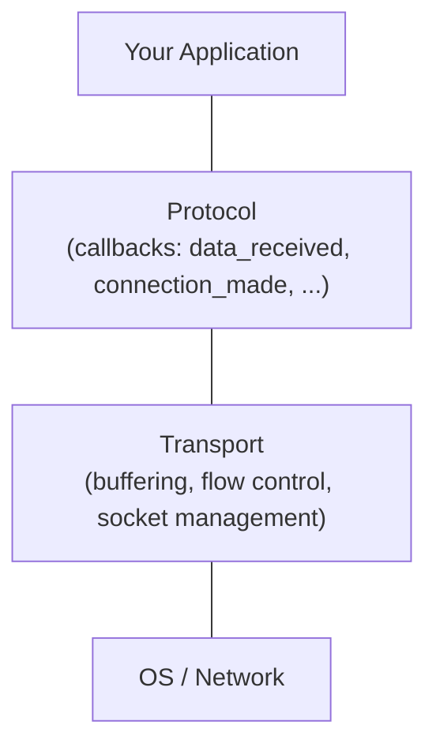
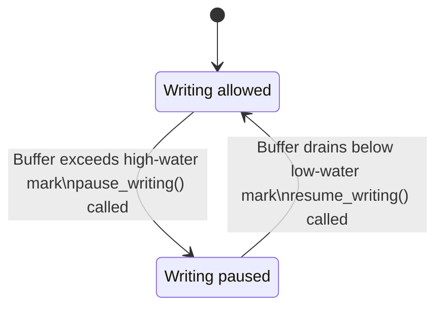

# Transports and Protocols

In Chapter 1 you learned the
[Streams API](../the-basics/streams.md) --
[`asyncio.open_connection()`][asyncio-open-connection] and
[`asyncio.start_server()`][asyncio-start-server] give you a `StreamReader` and `StreamWriter` that you
[`await`][await] like any other coroutine. That API is comfortable, familiar, and the
right choice for most networking code. But it is not the bottom of the stack.

Underneath every `StreamReader` and `StreamWriter` sits a *transport* and a
*protocol*. The transport handles the raw I/O mechanics -- buffering bytes,
managing the socket, negotiating TLS. The protocol handles events -- "a
connection was made", "data arrived", "the connection was lost". Streams are a
convenience layer that wraps this pair into an async/await-friendly interface.

This section gives you enough to understand the model and write a simple
protocol. The full API surface is large -- for the complete reference, see the
[official documentation on transports][official-documentation-on-transports]
and [protocols][protocols].

## The Model

The core idea is *separation of concerns*. A transport knows how to move bytes
over a specific kind of I/O channel (a TCP socket, a UDP socket, a pipe, an
SSL wrapper). A protocol knows what those bytes *mean* -- it implements your
application logic. The transport never parses a message, and the protocol never
touches a socket.



When a connection is established, asyncio creates a transport and a protocol,
wires them together, and calls `protocol.connection_made(transport)`. From that
point on, the protocol receives callbacks as data arrives, and uses the
transport to send data back. There is no [`await`][await] in sight -- this is a purely
callback-driven model.

The Streams API sits on top of this. When you call [`asyncio.open_connection()`][asyncio-open-connection],
asyncio creates a transport/protocol pair internally, wraps them in a
`StreamReader` and `StreamWriter`, and hands you the async/await interface.
The protocol is still there -- you just never see it.

## Transports

A transport is an object provided by asyncio -- you do not subclass it. It
represents the I/O channel and exposes methods for writing data and controlling
the connection. The hierarchy looks like this:

- [`BaseTransport`][basetransport]
  -- common base. Methods: `close()`, `is_closing()`, `get_extra_info()`.
- [`ReadTransport`][readtransport]
  -- adds `pause_reading()`, `resume_reading()`.
- [`WriteTransport`][writetransport]
  -- adds `write()`, `writelines()`, `write_eof()`, `can_write_eof()`,
  `abort()`, `set_write_buffer_limits()`, `get_write_buffer_size()`.
- [`Transport`][transport]
  -- combines [`ReadTransport`][readtransport] and [`WriteTransport`][writetransport]. This is the one you will
  interact with for TCP connections.

The key methods you use day-to-day:

- **`transport.write(data)`** -- buffer `data` for sending. This never blocks
  and never suspends -- it returns immediately. The event loop will flush the
  buffer to the OS when the socket is ready. This is the fundamental
  difference from `StreamWriter.drain()`: there is no coroutine to await.
- **`transport.close()`** -- flush remaining data and close the connection.
  The protocol's `connection_lost()` callback will fire once the close is
  complete.
- **`transport.get_extra_info(name)`** -- retrieve metadata about the
  connection. Common keys: `"peername"` (remote address), `"sockname"` (local
  address), `"socket"` (the raw socket object), `"ssl_object"` (TLS info).

!!! note

    `transport.write()` accepts `bytes`, not `str`. If you pass a string
    you get a `TypeError`. Encode your data before writing.

## Protocols

A protocol is the object *you* write. You subclass one of the protocol base
classes and override the callbacks you care about. Asyncio provides several
protocol bases:

- [`asyncio.Protocol`][asyncio-protocol]
  -- for stream-oriented connections (TCP).
- [`asyncio.DatagramProtocol`][asyncio-datagramprotocol]
  -- for connectionless transports (UDP).
- [`asyncio.SubprocessProtocol`][asyncio-subprocessprotocol]
  -- for communicating with child processes via pipes.

For TCP work, you subclass [`asyncio.Protocol`][asyncio-protocol] and override three callbacks:

- **`connection_made(transport)`** -- called once when the connection is
  established. Save the transport reference -- you will need it to send data.
- **`data_received(data)`** -- called whenever data arrives. `data` is a
  non-empty `bytes` object, but there are no message boundaries -- you may
  receive a partial message, a full message, or several messages in one call.
  Framing is your responsibility.
- **`connection_lost(exc)`** -- called once when the connection is closed.
  `exc` is `None` for a clean close, or an exception for an error.

Here is the simplest useful protocol -- an echo server that sends back
whatever it receives:

```python title="echo_protocol.py" hl_lines="5 10 14"
import asyncio


class EchoProtocol(asyncio.Protocol):
    def connection_made(self, transport: asyncio.Transport) -> None:
        self.transport = transport
        peername = transport.get_extra_info("peername")
        print(f"Connection from {peername}")

    def data_received(self, data: bytes) -> None:
        print(f"Received: {data.decode()!r}")
        self.transport.write(data)

    def connection_lost(self, exc: Exception | None) -> None:
        peername = self.transport.get_extra_info("peername")
        if exc:
            print(f"Connection from {peername} lost with error: {exc}")
        else:
            print(f"Connection from {peername} closed")


async def main() -> None:
    loop = asyncio.get_running_loop()

    server = await loop.create_server(
        lambda: EchoProtocol(),
        "127.0.0.1", 8888,
    )

    addrs = [s.getsockname() for s in server.sockets]
    print(f"Serving on {addrs}")

    async with server:
        await server.serve_forever()


if __name__ == "__main__":
    asyncio.run(main())
```

```text title="$ python echo_protocol.py"
Serving on [('127.0.0.1', 8888)]
```

You can test it with `nc` (netcat) or a telnet client:

```text
$ echo "hello" | nc 127.0.0.1 8888
hello
```

Compare this with the echo server from
[Streams](../the-basics/streams.md). The Streams version is a
coroutine with `await reader.readline()` and `await writer.drain()`. The
protocol version is a class with callbacks -- no coroutines, no [`await`][await]. The
protocol version is slightly more verbose, but it has zero per-message
coroutine overhead.

## [`loop.create_connection()`][loop-create-connection] and `loop.create_server()`

You have already seen `loop.create_server()` above. Both it and
[`loop.create_connection()`][loop-create-connection]
take a *protocol factory* -- a callable that returns a new protocol instance.
Typically this is a `lambda` or a class reference.

`loop.create_server()` creates a listening socket and calls the factory once
per incoming connection. [`loop.create_connection()`][loop-create-connection] opens a client connection
and calls the factory once for the outgoing connection. Both return the
transport and protocol:

```python title="echo_client_protocol.py"
import asyncio


class EchoClientProtocol(asyncio.Protocol):
    def __init__(self, message: str, on_done: asyncio.Future[None]) -> None:
        self.message = message
        self.on_done = on_done

    def connection_made(self, transport: asyncio.Transport) -> None:
        transport.write(self.message.encode())

    def data_received(self, data: bytes) -> None:
        print(f"Received: {data.decode()!r}")

    def connection_lost(self, exc: Exception | None) -> None:
        if not self.on_done.done():
            self.on_done.set_result(None)


async def main() -> None:
    loop = asyncio.get_running_loop()
    on_done: asyncio.Future[None] = loop.create_future()

    transport, protocol = await loop.create_connection(
        lambda: EchoClientProtocol("Hello, protocol!\n", on_done),
        "127.0.0.1", 8888,
    )

    await on_done
    transport.close()


if __name__ == "__main__":
    asyncio.run(main())
```

```text title="$ python echo_client_protocol.py"
Received: 'Hello, protocol!\n'
```

Notice the pattern: the client protocol uses a [`Future`][future] to signal completion
back to the coroutine world. This is the standard bridge between callback-based
protocols and async/await code -- create a future, pass it into the protocol,
and [`await`][await] it from your coroutine.

!!! warning

    The protocol factory (the first argument to `create_server()` and
    `create_connection()`) must return a *new* protocol instance each time
    it is called. Each connection gets its own protocol. Do not return the
    same instance for multiple connections.

## Flow Control

When data arrives faster than you can process or forward it, buffers grow
without bound. The transport/protocol layer handles this with explicit flow
control -- a form of *backpressure*.

On the **read side**, the transport controls the pace:

- **`transport.pause_reading()`** -- tell the transport to stop delivering
  `data_received()` callbacks. Data accumulates in the OS receive buffer. If
  that buffer fills up, TCP itself will apply backpressure to the sender.
- **`transport.resume_reading()`** -- start delivering data again.

On the **write side**, the protocol receives notifications:

- **`protocol.pause_writing()`** -- called by the transport when the write
  buffer exceeds the high-water mark. You should stop calling
  `transport.write()` until told otherwise.
- **`protocol.resume_writing()`** -- called when the buffer drains below the
  low-water mark. You can resume writing.

You can configure the water marks with
`transport.set_write_buffer_limits(high, low)`.



This is the same backpressure mechanism that drives `StreamWriter.drain()`.
When you call [`drain()`][drain] on a stream writer, it is checking whether the
underlying transport has asked the protocol to pause, and suspending your
coroutine until `resume_writing()` fires. The streams API hides the callbacks
behind an [`await`][await] -- but the machinery is the same.

!!! tip

    If you are implementing a proxy or relay (reading from one transport
    and writing to another), flow control is critical. When the downstream
    transport signals `pause_writing()`, call `pause_reading()` on the
    upstream transport. When `resume_writing()` fires, call
    `resume_reading()`. This chains backpressure end-to-end and prevents
    your proxy from buffering the entire data stream in memory.

## A Complete Example: Echo Server with Client

Here is both sides running in a single script, using only the protocol API:

```python title="echo_protocol_demo.py"
import asyncio


class EchoServerProtocol(asyncio.Protocol):
    def connection_made(self, transport: asyncio.Transport) -> None:
        self.transport = transport
        peername = transport.get_extra_info("peername")
        print(f"Server: connection from {peername}")

    def data_received(self, data: bytes) -> None:
        self.transport.write(data)

    def connection_lost(self, exc: Exception | None) -> None:
        print("Server: connection closed")


class EchoClientProtocol(asyncio.Protocol):
    def __init__(
        self,
        messages: list[bytes],
        on_done: asyncio.Future[list[bytes]],
    ) -> None:
        self.messages = list(messages)
        self.on_done = on_done
        self.received: list[bytes] = []

    def connection_made(self, transport: asyncio.Transport) -> None:
        self.transport = transport
        for msg in self.messages:
            transport.write(msg)

    def data_received(self, data: bytes) -> None:
        self.received.append(data)
        total = sum(len(r) for r in self.received)
        expected = sum(len(m) for m in self.messages)
        if total >= expected:
            if not self.on_done.done():
                self.on_done.set_result(self.received)
            self.transport.close()

    def connection_lost(self, exc: Exception | None) -> None:
        if not self.on_done.done():
            self.on_done.set_result(self.received)


async def main() -> None:
    loop = asyncio.get_running_loop()

    server = await loop.create_server(
        EchoServerProtocol, "127.0.0.1", 0,
    )
    port: int = server.sockets[0].getsockname()[1]
    print(f"Server: listening on port {port}")

    on_done: asyncio.Future[list[bytes]] = loop.create_future()
    messages = [b"Hello\n", b"Protocol\n", b"World\n"]

    transport, protocol = await loop.create_connection(
        lambda: EchoClientProtocol(messages, on_done),
        "127.0.0.1", port,
    )

    results = await on_done
    print(f"Client received: {b''.join(results).decode().strip()!r}")

    server.close()
    await server.wait_closed()


if __name__ == "__main__":
    asyncio.run(main())
```

```text title="$ python echo_protocol_demo.py"
Server: listening on port 43210
Server: connection from ('127.0.0.1', 54321)
Client received: 'Hello\nProtocol\nWorld'
Server: connection closed
```

The server protocol is four lines of logic. The client protocol is more
involved because it needs to track how much data has been received and signal
completion through a future. This is the fundamental trade-off of the protocol
API: you handle state management and signaling yourself, rather than letting
the streams layer do it for you.

## When to Use Transports and Protocols

For most networking code, the Streams API is the right choice. It gives you
[`await`][await]-based reads and writes, automatic backpressure through [`drain()`][drain], and
a simpler mental model. Use protocols and transports when:

- **You are implementing a custom wire protocol** -- binary framing, WebSocket
  handshakes, database client protocols. The callback model maps naturally to
  state machines, and you avoid the overhead of coroutine suspension on every
  message.
- **You need maximum throughput** -- protocols have less overhead than streams.
  There is no `StreamReader` buffer copy, no coroutine creation per read, no
  future allocation for [`drain()`][drain]. For high-throughput proxies or message
  brokers, this can matter.
- **You are building a proxy or relay** -- the transport-level flow control
  (`pause_reading` / `resume_reading`) gives you direct control over
  backpressure between the upstream and downstream connections.
- **You are integrating with a library that provides a protocol** -- some
  third-party libraries (HTTP parsers, protocol state machines) are designed
  to feed data into a callback interface. Wrapping them in a protocol class
  is more natural than piping through a stream.

For everything else -- HTTP clients, simple TCP services, scripting, CLI tools
-- use Streams. They exist specifically so you don't have to write protocol
classes for routine networking.

!!! warning

    Do not mix the two layers carelessly. If you are using `StreamReader`
    and `StreamWriter`, do not also call methods on the underlying
    transport directly (like `transport.pause_reading()`) unless you
    understand how the stream layer uses those methods internally. The
    stream layer manages flow control on your behalf -- bypassing it can
    cause lost data or deadlocks.

---

[asyncio-open-connection]: https://docs.python.org/3/library/asyncio-stream.html#asyncio.open_connection
[asyncio-start-server]: https://docs.python.org/3/library/asyncio-stream.html#asyncio.start_server
[await]: https://docs.python.org/3/reference/expressions.html#await
[official-documentation-on-transports]: https://docs.python.org/3/library/asyncio-transport.html
[protocols]: https://docs.python.org/3/library/asyncio-protocol.html
[basetransport]: https://docs.python.org/3/library/asyncio-transport.html#asyncio.BaseTransport
[readtransport]: https://docs.python.org/3/library/asyncio-transport.html#asyncio.ReadTransport
[writetransport]: https://docs.python.org/3/library/asyncio-transport.html#asyncio.WriteTransport
[transport]: https://docs.python.org/3/library/asyncio-transport.html#asyncio.Transport
[asyncio-protocol]: https://docs.python.org/3/library/asyncio-protocol.html#asyncio.Protocol
[asyncio-datagramprotocol]: https://docs.python.org/3/library/asyncio-protocol.html#asyncio.DatagramProtocol
[asyncio-subprocessprotocol]: https://docs.python.org/3/library/asyncio-protocol.html#asyncio.SubprocessProtocol
[loop-create-connection]: https://docs.python.org/3/library/asyncio-eventloop.html#asyncio.loop.create_connection
[future]: https://docs.python.org/3/library/asyncio-future.html#asyncio.Future
[drain]: https://docs.python.org/3/library/asyncio-stream.html#asyncio.StreamWriter.drain